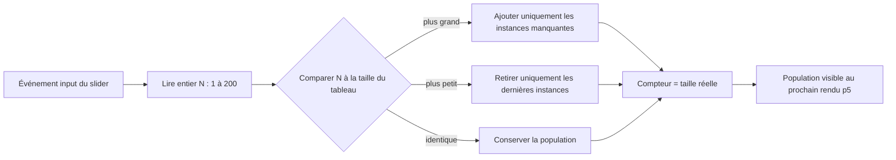
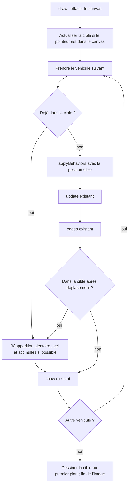
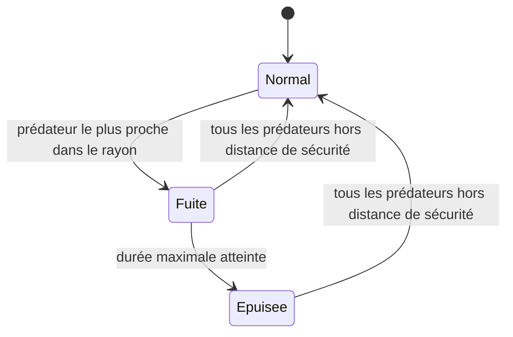

# EXO 1 — Population de véhicules, rebouclage et réapparition

**Projet :** `SteeringBehavioursM2IA2_2026_2027` — dossier `1-Seek`.
**Date :** 12 octobre 2026.
**Statut :** spécification approuvée et implémentée le 12 octobre 2026. Voir [README.md](README.md) pour l’utilisation et les tests.

## 1. Objectif

Étendre la démonstration actuelle pour afficher de **1 à 200 véhicules**, tous pilotés par le comportement `seek()` existant et poursuivant la même cible autonome `Target`.

Trois fonctionnalités sont demandées :

1. Un slider modifie le nombre de véhicules pendant son déplacement, sans attendre son relâchement.
2. Un véhicule qui sort par un bord réapparaît du côté opposé grâce à `Vehicle.edges()`.
3. Un véhicule qui atteint la cible réapparaît à une position aléatoire.

La règle de réapparition est une règle de gestion de la scène. Le steering reste celui fourni : calcul d’une force, `applyForce()`, puis locomotion dans `update()`. Aucun déplacement direct ne sera ajouté à `seek()`.

## 2. Choix proposés

| Paramètre | Proposition |
|---|---|
| Population initiale | **20 véhicules**, afin de rendre la démonstration collective visible dès l’ouverture |
| Nombre minimal / maximal | **1 / 200**, bornes incluses |
| Pas du slider | **1**, uniquement des entiers |
| Indication du nombre | `Véhicules : N / 200`, synchronisée avec la population réelle |
| Vitesse et force | Valeurs existantes et identiques pour tous : `maxSpeed = 4`, `maxForce = 0.1` |
| Apparence des véhicules | Triangle bleu, contour blanc, flèche de vitesse rouge, comme actuellement |
| Cible | Instance autonome de `Target`, avec rayon et position variables |
| Critère d’arrivée | Distance entre les centres **≤ `vehicle.r + target.r`** |
| Réapparition sur la cible | Nouvelle position dans le canvas, vitesse et accélération nulles |
| Réapparition au bord | Comportement exact de `edges()`, sans modifier vitesse ni accélération |

Les valeurs initiales et le seuil d’arrivée sont des choix proposés ici ; ils n’étaient pas précisés dans la demande.

## 3. Slider et gestion de la population

### Interaction immédiate

Utiliser un slider HTML natif ou celui créé par p5, avec une gestion de l’événement **`input`**. L’événement `change` seul ne satisfait pas la demande, puisqu’il peut n’arriver qu’à la validation ou au relâchement.

À chaque événement `input` :

1. Lire et valider un entier entre 1 et 200.
2. Ajuster immédiatement le tableau de véhicules à cette taille.
3. Mettre à jour le texte avec le nombre réellement présent.
4. Dessiner cette population dès la prochaine image p5, sans attendre la fin du geste.

« Immédiat » signifie ici que le traitement démarre sur `input`, puis que le résultat visuel apparaît au prochain rendu disponible. Le navigateur peut regrouper des événements ou ralentir un onglet en arrière-plan ; aucun délai artificiel, debounce ou attente du relâchement ne sera ajouté.

### Conservation de l’état

- **Augmentation :** conserver tous les véhicules existants et ajouter seulement ceux qui manquent, à des positions aléatoires valides et avec une vitesse nulle.
- **Diminution :** supprimer les derniers éléments du tableau. Conserver les positions, vitesses et identités des véhicules restants.
- **Valeur inchangée :** ne rien recréer.
- Un véhicule supprimé puis réajouté sera une nouvelle instance. Il n’est pas nécessaire de mettre en cache les instances supprimées.
- Aucune collision ni séparation entre véhicules n’est demandée : ils peuvent se croiser ou se superposer.

### Réglages de mouvement et d’ambiance

Deux curseurs supplémentaires modifient immédiatement les paramètres communs des véhicules : `maxSpeed` de 0 à 20 et `maxForce` de 0 à 10. Une valeur choisie s’applique à toutes les instances présentes ; les instances ajoutées ensuite héritent des mêmes réglages. La vitesse déjà acquise est limitée à la nouvelle vitesse maximale.

Le canvas affiche un dégradé radial arc-en-ciel lumineux et animé. Deux curseurs contrôlent sa vitesse et son intensité. Son centre suit progressivement la souris en conservant une oscillation autonome. La coordonnée X du centre règle un filtre passe-bas (120–8000 Hz), Y la hauteur (360–90 Hz). La souris X règle la fréquence du modulateur (1–10 Hz) et sa profondeur. Les couleurs, le rayon et la luminosité lisent ce même signal FM avec un analyseur Web Audio. Le bouton musique active l'ensemble de la synthèse ; à l'arrêt il coupe le mix, détruit toutes les sources et ferme le contexte. L'animation autonome du gradient continue sans FM lorsque la musique est coupée. Voir `audio.js` et les mesures de signal dans `tests/audio-browser.html`.

Le même réglage doit fonctionner à la souris, au tactile et au clavier. Le slider aura un libellé associé ; le texte restera visible pendant le geste. Éviter une annonce vocale forcée pour chaque incrément pendant un glissement rapide.

## 4. Cible et interface

Prévoir une petite barre de contrôle au-dessus du canvas, avec le libellé, le slider et le compteur. Le canvas occupe l’espace disponible en dessous : la barre ne doit pas cacher les véhicules ni intercepter la souris au milieu de la scène.

La cible est une instance autonome de `Target`. Elle conserve son déplacement, son changement de rayon et son changement de couleur fournis par `target.js` ; elle est mise à jour puis rebouclée avec `edges()` à chaque image.

Pour respecter la règle locale selon laquelle toute entité visible dérive de `Vehicle`, utiliser la classe existante **`Target extends Vehicle`**, dans `target.js` :

- rendu du disque rouge ;
- rayon visuel variable fourni par `Target` ;
- position et animation fournies par `Target.update()` ;
- aucun contrôle souris requis.

La cible normale se déplace par steering vers une direction aléatoire, avec intégration héritée de Vehicle. Les véhicules reçoivent sa position vectorielle, par exemple via `target.pos`.

La cible est autonome : sa position, son rayon et sa couleur évoluent selon le comportement déjà fourni par `Target`.

## 5. Réapparition au bord

Appeler **`vehicle.edges()` après `vehicle.update()` et avant le dessin** de chaque véhicule qui n’a pas été réinitialisé avant son déplacement.

Respecter exactement la méthode fournie :

| Condition après déplacement | Nouvelle coordonnée |
|---|---|
| `pos.x > width + r` | `pos.x = -r` |
| `pos.x < -r` | `pos.x = width + r` |
| `pos.y > height + r` | `pos.y = -r` |
| `pos.y < -r` | `pos.y = height + r` |

Les comparaisons sont strictes : être exactement à `width + r` ou `-r` ne déclenche pas encore le rebouclage. Le véhicule franchit une marge égale à `r` avant d’être replacé de l’autre côté ; on ne remplace pas cette règle par un test sur son centre à `0` ou `width`.

- Préserver la composante de position de l’autre axe.
- Préserver la vitesse, afin de continuer dans la même direction.
- Si les deux axes sont dépassés, traiter les deux dans la même image.
- Ne pas recopier cette logique dans un autre fichier.
- Le monde présente une continuité de position aux bords, mais **seek continue d’utiliser la distance euclidienne habituelle**. Il ne choisit pas automatiquement le trajet le plus court à travers un bord : une modification du steering torique est hors périmètre.

## 6. Arrivée sur la cible et réapparition aléatoire

### Définition d’« atteindre »

Un véhicule atteint la cible lorsque :

```text
(pos.x - target.pos.x)² + (pos.y - target.pos.y)² ≤ (vehicle.r + target.r)²
```

Le test utilise la somme des rayons du véhicule et de la cible. Il s’agit d’une collision simplifiée disque/disque, recalculée selon la taille actuelle de la cible.

Contrôler l’arrivée avant le déplacement, puis de nouveau après `update()` et `edges()`. Le seuil est recalculé à chaque image à partir de `vehicle.r + target.r`, ce qui tient compte des changements de taille de `Target`. Une collision balayée exacte reste hors périmètre.

### Réinitialisation d’un véhicule

Lorsqu’une arrivée est détectée :

1. Tirer une nouvelle position valide à l’intérieur du canvas.
2. Modifier la position de **la même instance**, sans changer la taille du tableau.
3. Remettre `vel` et `acc` à `(0,0)`.
4. Conserver `maxSpeed`, `maxForce`, `r` et l’apparence.
5. Dessiner le véhicule à sa nouvelle position. Ne pas effectuer une seconde mise à jour de locomotion dans la même image.

Le véhicule recommence à poursuivre la cible à l’image suivante. Il n’y a ni disparition temporisée, ni nouvelle cible, ni ajout d’instance.

Cette téléportation doit rester dans une fonction de gestion de scène, distincte de `seek()`, `applyForce()` et `update()`.

### Tirage sûr et borné

Réutiliser la même règle de tirage pour l’initialisation, l’ajout par slider et la réapparition :

- coordonnées dans le canvas ; préférer une marge `r` sur chaque bord quand la taille le permet ;
- nouvelle position située à une distance strictement supérieure à `target.r + vehicle.r + 4` de la cible ;
- pas de contrainte d’écartement entre véhicules ;
- au maximum **32 tentatives aléatoires**, puis choix déterministe du coin admissible le plus éloigné de la cible ;
- si la marge `r` empêche une position valide dans un petit canvas, élargir la recherche à tout le canvas et à ses coins ;
- si aucune position ne peut être située hors de la zone d’exclusion, ne jamais boucler indéfiniment. Pour un ajout, utiliser le point disponible le plus éloigné ; pour une arrivée, différer la réapparition et conserver le véhicule jusqu’à une configuration permettant le tirage. La population doit toujours correspondre au slider.

Cette dernière règle concerne les canvas exceptionnellement petits. Elle garantit que l’application continue à répondre, même si la géométrie demandée devient impossible.

Un véhicule ne peut être réinitialisé **qu’une fois par image**. Comme `Target` se déplace continuellement, il peut atteindre à nouveau la zone d’arrivée à une image ultérieure et réapparaître une nouvelle fois.

## 7. Workflow proposé



## 13. [DONE] Plusieurs cibles

Le curseur `Cibles` règle en temps réel le nombre de cibles entre 1 et 30, avec 4 par défaut. Les collections normale et fuyante restent parallèles afin de préserver les instances lors d'un changement de scénario. Pour chaque véhicule, `SeekPopulation.nearestTarget()` sélectionne la cible la plus proche avant l'application de `seek()` et de la règle de réapparition. Chaque cible fuyante conserve toutefois son propre état de perception, de fuite et d'endurance.

## 14. [DONE] Effets synthétiques WebAudioX

`libraries/webaudiox.js` est la distribution officielle WebAudioX. `effectsAudio.js` utilise son générateur `getBufferFromJsfx()` pour créer les buffers en mémoire, puis les joue dans le même contexte audio que la musique. Chaque cible fuyante possède une source bouclée indépendante, arrêtée dès que son état quitte `fleeing`, accompagnée d'un sweep oscillant du grave vers l'aigu pendant la fuite. Une détection déclenche une alarme de 0,4 seconde, avec un cooldown d'une seconde par cible. Une collision qui provoque une réapparition déclenche une explosion de 0,7 seconde. L'API `playDecoyRelease()` est prévue pour le largage de leurres ; aucun événement de leurre n'est encore présent dans le projet G1.

Deux curseurs indépendants règlent les gains des bus musique et effets, sans modifier les paramètres de synthèse ni interrompre les sources audio.

La synchronisation des effets utilise les états actuels de toutes les cibles actives : démarrer une source par cible en fuite, y compris lors d'une activation audio tardive ; arrêter les sources à la sortie de fuite, à la suppression d'une cible ou au changement de scénario. L'alarme et le sweep sont propres au scénario 2. La validation comprend des tests des sources simultanées et des mesures RMS des buffers réellement générés par WebAudioX/jsfx.



En cas d’impossibilité de réapparition dans un canvas trop petit, la branche de réinitialisation diffère l’opération sans exécuter plusieurs pas ou modifier la population.

## 8. Organisation de l’implémentation future

| Fichier | Modification envisagée |
|---|---|
| `sketch.js` | Remplacer le véhicule global implicite par un tableau explicitement déclaré ; initialiser la population ; gérer le slider et orchestrer les étapes de chaque image |
| `population.js` | Fonctions de redimensionnement de la population, détection d’arrivée et tirage/réinitialisation ; aléatoire injectable pour les tests |
| `target.js` | Entité `Target extends Vehicle`, cible autonome de la scène |
| `index.html` | Charger les nouveaux scripts dans l’ordre adapté et fournir les éléments de contrôle si l’interface n’est pas créée par p5 |
| `style.css` | Disposer la barre de contrôle et le canvas, conserver des commandes lisibles et utilisables au tactile |
| `tests/*.test.mjs` | Tests automatisés du comportement et des cas limites dans le dossier `1-Seek` |
| `vehicle.js` | **Aucune modification** : réutiliser `applyBehaviors()`, `update()`, `edges()` et `show()` |
| `target.js` | Aucun changement nécessaire ; classe autonome existante non utilisée par cette démonstration |

Un tableau de véhicules ordinaires suffit : ils partagent le comportement existant. Il n’est pas nécessaire de dupliquer `Vehicle`, son calcul de seek ou sa locomotion pour la population.

Les helpers de gestion ne doivent pas devenir de nouvelles classes d’entités visibles. Ne pas créer de timer par véhicule ; une seule boucle p5 met à jour toute la population.

Le redimensionnement de la fenêtre n’est pas une quatrième fonctionnalité demandée. Si un ajustement du canvas est ajouté pour maintenir la disposition barre/canvas, il doit préserver les instances et leurs vitesses, recaler la cible dans le canvas et réutiliser `edges()` pour les véhicules hors limites.

## 9. Critères d’acceptation

### Population et interaction

- À l’ouverture, 20 véhicules poursuivent la même cible.
- Le slider accepte tous les entiers de 1 à 200, sans dépasser les bornes.
- Pendant un glissement maintenu, plusieurs valeurs intermédiaires modifient le compteur et la population visible avant le relâchement.
- Passer de 20 à 35 conserve les 20 premières instances et en ajoute 15.
- Revenir de 35 à 8 conserve les 8 premières instances sans les réinitialiser.
- Le clavier permet également d’ajuster le nombre ; le texte affiche toujours la taille effective du tableau.
- Manipuler le slider ne déplace pas la cible vers les coordonnées de l’interface.

### Bords

- Un dépassement de chacun des quatre seuils provoque le repositionnement exact prévu par `edges()`.
- Les égalités aux seuils ne déclenchent pas prématurément le rebouclage.
- Un dépassement simultané sur deux axes traite les deux axes.
- La vitesse reste inchangée pendant un rebouclage.

### Cible

- À une distance supérieure à `target.r + vehicle.r`, le véhicule continue son seek normal.
- À cette distance ou moins, il réapparaît selon les règles de tirage.
- Une arrivée avant le déplacement est détectée, de même qu’une arrivée après déplacement/rebouclage.
- Une réapparition conserve l’instance et le nombre de véhicules ; la vitesse et l’accélération sont nulles.
- La position tirée n’est pas immédiatement dans la zone d’arrivée, lorsque la géométrie le permet.
- Plusieurs véhicules peuvent atteindre la cible dans la même image et sont traités indépendamment.
- Si le slider supprime ou ajoute des véhicules pendant leur poursuite, l’état reste cohérent et aucune référence supprimée n’est mise à jour ensuite.

## 10. Vérifications à prévoir pendant l’implémentation

Le dépôt demande des tests pour chaque nouvelle fonctionnalité. Aucun lanceur utilisable n’existe actuellement dans `1-Seek` et `test.js` ne contient qu’un commentaire. Prévoir un lanceur léger, par exemple les tests natifs Node, avec une commande documentée depuis `1-Seek` :

```sh
node --test tests/*.test.mjs
```

Cette commande est maintenant disponible. Les 8 tests automatisés passent ; le rendu p5, les curseurs, le fond animé et l'activation audio ont également été vérifiés dans le navigateur. Le seul ancien message console observé provenait d'une exécution précédente avant correction du passage de la cible à `seek()`.

| Famille de tests | Cas essentiels |
|---|---|
| Population | Bornes 1/200, hausse/baisse/valeur identique, conservation d’identité et d’état, entrées invalides rejetées par les helpers |
| Interaction | Déclencher `input` sans déclencher `change` ni relâcher ; vérifier population et compteur ; compléter par un glissement réel dans le navigateur |
| Steering existant | Tous les véhicules utilisent le même seek ; force limitée à `maxForce`, vitesse limitée à `maxSpeed`, cible non mutée par seek |
| Rebouclement | Quatre bords, valeurs exactement aux seuils, angles du canvas, conservation des composantes et de la vitesse |
| Arrivée | Juste dehors, égalité et intérieur du seuil ; détection avant/après mouvement ; une réapparition au maximum par image |
| Tirage | Aléatoire injecté, marges, exclusion de la cible, limite de tentatives, repli déterministe, canvas petit ou géométrie impossible |
| Réinitialisation | Même instance, même effectif, paramètres conservés, vitesse et accélération remises à zéro |
| Intégration | Slider 1 → 200 → 1 pendant un geste, passages de bord et arrivées simultanées, interface utilisable et absence d’erreurs navigateur |

Les tests des règles de gestion doivent rester reproductibles. Les tests de locomotion doivent exercer les méthodes réellement fournies par `Vehicle`, sans en recopier l’algorithme dans le code applicatif. Une vérification dans le navigateur avec p5 réel complétera les tests isolés, notamment pour le rendu et l’événement `input`.

À 200 véhicules, le traitement doit rester proportionnel à la population : une boucle de mise à jour/dessin et des tirages bornés, sans comparaison systématique entre toutes les paires. Aucun engagement de cadence universelle n’est fixé ; mesurer le comportement dans le navigateur de validation et signaler une baisse notable plutôt que promettre 60 images/s sur toute machine.

## 11. Hors périmètre et livrable actuel

Restent hors périmètre : pursue, arrive, collisions entre véhicules, séparation/flocking, obstacles, cibles multiples simultanées, réglages individuels, trajectoires toroidales optimales et refonte du pas de temps. La fuite et les scénarios sont désormais inclus dans la section suivante.

Cette proposition respecte les frontières de [l’architecture](../ARCHITECTURE.md) et les [consignes du dépôt](../AGENTS.md). Le modèle de steering reste celui discuté dans l’[analyse de `1-Seek`](ANALYSE.md) et dans l’article de Reynolds fourni au dépôt.

**Historique :** cette spécification a d’abord été livrée seule, sans modification du code. Après approbation, les fonctionnalités ont été implémentées dans `sketch.js` et `population.js`, avec adaptation de `index.html` et `style.css`, tests dans `tests/population.test.mjs` et documentation dans `README.md`. `vehicle.js` reste inchangé ; l’évolution de Target vers un pilotage par steering est décrite ci-dessous.

## 12. [DONE] Sélection de scénarios, cible fuyante et endurance

Cette section précise le comportement actuel et complète les choix initiaux. La population démarre à 20 véhicules, réglable de 1 à 200 ; les réglages existants de vitesse, force, dégradé et musique sont conservés.

### Scénario 1 — suivi et réapparition

Conserver la cible autonome `Target` et le seek des véhicules. Le contact selon la somme des rayons provoque une réapparition aléatoire de la même instance, avec vitesse/accélération nulles, comme auparavant. La cible conserve ses changements de direction, rayon et couleur ; sa direction est désormais pilotée par `seek()` et son horloge locale remplace le timer qui imposait directement les vitesses.

### Scénario 2 — fuite

Créer `TargetFutante extends Target` dans `targetFutante.js` (nom demandé), avec héritage indirect de Vehicle. Ne modifier aucun `vehicle.js` et réutiliser la méthode héritée `super.flee(threat.pos)`.

| Paramètre | Défaut | Curseur |
| --- | --- | --- |
| Rayon de déclenchement | 200 px | 50–500 px |
| Distance de sécurité | 300 px | 100–800 px, toujours supérieure à la détection |
| Durée maximale | 2,5 s | 0,5–10 s |
| Multiplicateur de vitesse max | 2 | Fixe |
| Multiplicateur de force max | 4 | Fixe |

La détection mesure la distance entre centres, seuil inclus. Choisir le véhicule le plus proche. Pendant la fuite, rechercher le plus proche parmi tous les prédateurs ; ne pas interrompre dès qu'il dépasse le cercle de 200 px. La sortie intervient lorsque la distance minimale atteint 300 px (ou le réglage courant), lorsque les prédateurs disparaissent, ou à l'expiration de la durée maximale.

Restaurer exactement les limites normales à la sortie. En cas d'épuisement, conserver un état explicite empêchant un nouveau déclenchement avant que tous les prédateurs soient hors de la distance de sécurité. Ensuite restaurer l'endurance et autoriser une nouvelle détection.

Dans tous les états normaux ou épuisés, utiliser le comportement de Target par défaut. Dans l'état de fuite, remplacer son steering normal par le flee hérité, en intégrant une seule fois la locomotion. Le changement de scénario réinitialise la fuite, l'endurance et la menace, sans recréer les véhicules. Seule la cible du scénario actif est actualisée.

### Rendu et debug

Afficher la barre d'endurance au-dessus de la cible dans le scénario 2 : pleine en état normal, décroissante pendant la fuite, vide après épuisement. La touche D et la case Debug sont synchronisées ; les frappes dans les contrôles ne basculent pas le debug. Le cercle de détection est visible uniquement en debug : jaune sans prédateur à portée, rouge si au moins un se trouve dans le rayon. Les vecteurs de vitesse suivent le même mode debug via une sous-classe dédiée.

### Tests et validation

`tests/scenarios.test.mjs` couvre héritage, valeurs par défaut, seuil inclusif, choix de menace, boosting, appel de la méthode héritée, intégration unique, distances entre détection et sortie, durée exacte, endurance, épuisement/réarmement, paramètres en direct, rendu debug, transitions, réapparition dans les deux scénarios et sélection multi-cibles. Les tests existants de population et d'audio sont conservés. **25 tests réussis**, complétés par validation avec le vrai p5.js dans Chrome, y compris les seuils après intégration flottante et le redimensionnement sur petit écran.


